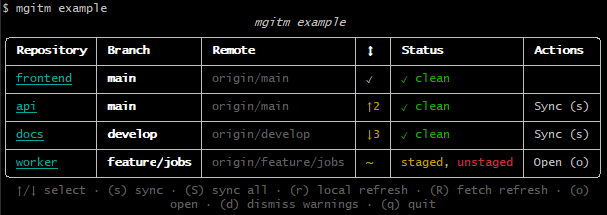

# mgitm (multi-git-manager)

`mgitm` scans the current directory for Git repositories, fetches their remotes, and displays an interactive live status table. You can review all the repos at once, sync them, open them, manage their branches...



## Installation

```bash
pip install multi-git-manager
```

Requires Python 3.10+ and Git on `PATH`.

## Usage

```bash
mgitm status
```

`status` finds direct-child repositories, refreshes their status, and fetches remotes in the background. GitHub-hosted repositories are fetched last so an interactive authentication prompt cannot prevent other repositories from being updated.

The table stays open in an interactive terminal. Use these controls:

| Key | Action |
|---|---|
| `↑` / `↓` | Select the previous or next repository. The selected row has a `▶` marker. |
| `s` | Sync the selected clean repository. |
| `S` | Sync every eligible clean repository. |
| `r` | Refresh local Git status without fetching. |
| `R` | Start a background fetch refresh. |
| `o` | Open the selected repository in a new VS Code window. |
| `d` | Dismiss live warnings and errors. |
| `q` or Ctrl+C | Quit. |

Clean repositories that are ahead or behind show `Sync (s)` in **Actions**. For a diverged branch, sync fetches and rebases local commits onto the tracking branch before pushing. If the rebase has conflicts, the table shows `rebase conflict` and offers `Open (o)` to open the repository in VS Code. Dirty repositories also offer `Open (o)` when VS Code is installed.

Warnings and errors appear beneath the table as they occur; press `d` to clear them.

### Other commands

```bash
# Show every local branch for each repository
mgitm status --branch_all

# Read status without fetching remotes
mgitm status --no-fetch

# Print a deterministic four-repository demo table
mgitm example

# Copy direct-child repositories to another directory
mgitm copy "D:\\work\\repository-backup"

# Copy only named repositories (spaces after commas are optional)
mgitm copy "D:\\work\\repository-backup" --repos="frontend, api"
```

`--branch_all` marks the currently checked-out branch with `→`. Working-tree status and Actions apply to that checked-out branch. In this mode, `↑` / `↓` select individual branch rows and `c` checks out the selected branch. After a successful checkout, mgitm refreshes the repository so its new current branch can be synced with `s`. Press `D` to delete a selected non-current branch only when it is fully merged into the current branch; mgitm asks for confirmation before deleting and refreshes the table afterwards.

### Copy repositories

`mgitm copy <destination>` copies every direct-child Git repository into the destination, including its `.git` directory. Quote the destination when it has spaces. Installed dependencies and disposable caches are omitted (including `node_modules`, virtual environments such as `.venv-*`, `.tox`, `.gradle`, and Python/tool caches), so run each project's usual dependency install command afterwards.

If a target repository directory already exists, mgitm asks whether to delete and replace it, merge into it (with source files overwriting target files), or skip it. The destination cannot be inside a repository being copied.

Pass `--repos=<comma-separated names>` to copy only selected direct-child repositories. Names are trimmed around commas and may be quoted; unknown names are reported and skipped.

## Columns

| Column | Meaning |
|---|---|
| Repository | Repository directory. In supported terminals, clicking the name opens it in VS Code. |
| Branch | Currently checked-out branch. |
| Remote | Tracking branch, if configured. |
| ↕ | Ahead / behind commit counts. |
| Status | Cleanliness, changes, fetch failures, or rebase conflicts. |
| Actions | Available keyboard-triggered sync or open actions. |

## Commands

| Command | Description |
|---|---|
| `mgitm status` | Live multi-repository status and keyboard controls. |
| `mgitm status --branch_all` | Show all local branches. |
| `mgitm status --no-fetch` | Skip the initial remote fetch. |
| `mgitm copy <destination> [--repos=names]` | Copy selected child repositories, excluding installed dependencies and caches. |
| `mgitm example` | Show the dummy example table. |
| `mgitm --help` | Show top-level help. |
